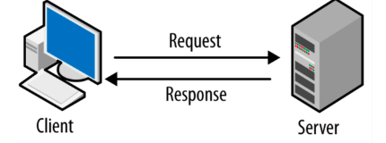
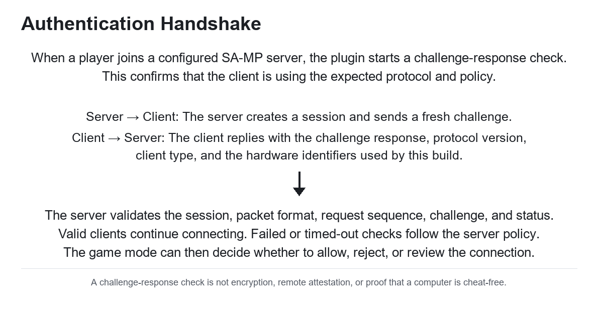
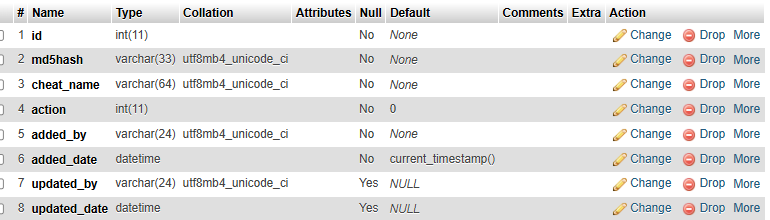
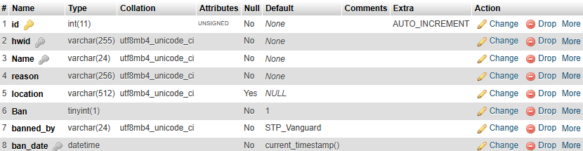
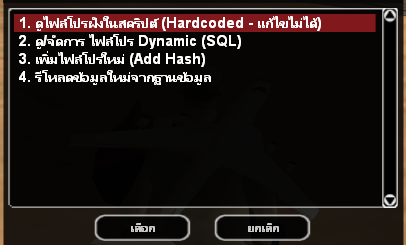
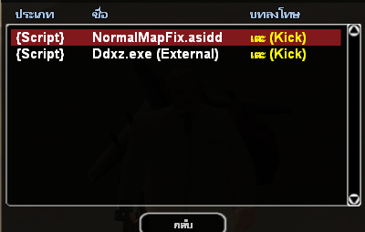
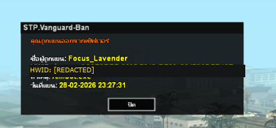
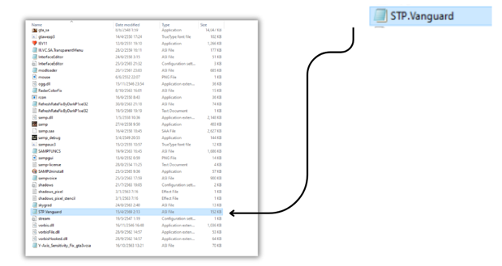

# STP-Vanguard

**A basic client/server anti-cheat layer for GTA San Andreas Multiplayer (SA-MP).**  
Final source release · Version 9.11.0 · Windows x86 · Pawn / C++

> STP-Vanguard provides extra checks and server-side reporting. It is a basic anti-cheat layer, **not a guarantee that cheating is impossible or that every detection is correct**. Keep gameplay validation and moderation rules on the server.

[ภาษาไทย](#ภาษาไทย) · [How it works](#how-it-works) · [Installation](#installation) · [Database](#database-schema)

**Development period:** December 26, 2025 – May 17, 2026. Version 9.11.0 is the final version from the original development period and is being shared as a source release.

---

## What is STP-Vanguard?

STP-Vanguard is a small anti-cheat system for SA-MP servers. It combines:

- **Client ASI module:** periodically checks selected game state and scans relevant files, loaded modules, and processes.
- **Windows server plugin:** establishes and validates the client connection, tracks scan status, and passes events to Pawn.
- **Pawn scripts:** decide how a server handles detections, timeouts, recoveries, and optional database actions.
- **Optional MySQL integration:** stores dynamic file signatures and HWID ban records. The database schema and example scripts are included.

Two client builds are included:

| Folder | Client policy |
| --- | --- |
| `AC_STP` | Allows normal CLEO / SAMPFUNCS installations while continuing to scan for cheat signatures |
| `AC_STP (nocleo)` | Disallows CLEO / SAMPFUNCS and related script files |

The two builds share the same transport and scanner source; they differ in their client policy. Install only one client ASI at a time.

A simplified view of the protocol exchange:

~~~mermaid
sequenceDiagram
    participant C as Client ASI
    participant S as SA-MP Server Plugin
    C->>S: Hello
    S-->>C: Session challenge
    C->>S: Version, policy, HWIDs, scan and integrity status
    S->>S: Validate packet, session, nonce and sequence
    S-->>C: Accepted / rejected
    loop Heartbeat and reports
        S->>C: Check request
        C->>S: Status or report
        S-->>C: ACK
    end
~~~

## How it works

### 1. Connection and verification handshake

When the client connects to a configured SA-MP server, it sends a Hello message. The plugin creates a session ID and a fresh challenge using the operating system random source, then asks the client to verify. The client responds with protocol version, client policy, the two hardware identifiers used by this build, scanner progress, and integrity status.

Before accepting a client, the server checks packet size and format, session, request sequence, challenge value, and status. Old handshake packets from 9.10.0 are not compatible; update the client and server plugin together.

The handshake challenge helps reject stale responses and confirms that the expected protocol is active. **It is not packet encryption, remote attestation, or proof that a computer is cheat-free.**

### 2. Periodic checks and reports

The client runs checks on background work scheduled separately from the game’s receive hook. The current scan intervals are:

| Check | Approximate interval |
| --- | ---: |
| Game values, including selected stamina / megajump checks | 1.8 seconds |
| Loaded modules | 7 seconds |
| External processes | 9 seconds |
| Files | 45 seconds |
| Client code integrity page | 32 KiB at a time, every 250 ms |

File hashes are cached by path, size, and modification time; cached entries are forced to refresh after at most 60 seconds. Hashing is split into smaller pieces so the scan can yield time back to the game.

The client queues up to 256 reports and waits for an acknowledgement (ACK) before advancing the report queue. Reports carry sequence numbers so a repeated packet does not trigger the same Pawn callback twice. The transport sends at most about 16 reports per second on ordered channel 7, separate from the game's regular channel. A missing response is retried with 1 / 2 / 4 / 8 second backoff; the server allows up to 45 seconds without a valid response before reporting a timeout. Heartbeats run every 10 seconds.

### 3. Pawn callbacks and server policy

After verification, the server invokes the existing Pawn callbacks once, in this order:

1. Connect
2. Client type
3. HWID
4. HWID V2

The plugin waits for the player's SA-MP object to exist (using `IsPlayerConnected` when available; otherwise a short fallback wait) before dispatching callbacks.

The plugin exposes `OnPlayerAntiCheatTimeout(playerid, 0)` and `OnPlayerAntiCheatRecovered(playerid, 1)`. A game mode can decide whether to warn, retry, kick, log, or take another action. A network timeout alone is not proof of cheating; avoid permanent bans based only on a missing heartbeat.

### 4. Detection and integrity checks

The scanner compares selected file hashes and signatures, checks loaded modules and external processes, and monitors selected game values. The CLEO-allowed build skips only the normal CLEO / SAMPFUNCS signatures; it does not disable other cheat checks. The project also includes a post-load baseline check of the ASI code pages. A later change to the monitored code prevents the client from renewing its verified state.

The integrity check begins after the ASI has loaded. It cannot reliably prove that the file was unmodified before loading, and a user controlling their own computer can still inspect, patch, replace, or emulate the client. Server-side gameplay checks remain important.

### 5. Optional dynamic signatures and HWID records

The included Pawn scripts can load dynamic MD5 signatures from `dynamic_cheats` and consult `banned_hwids`. The scripts can be adapted to the server's existing database and moderation flow. Import the schema in [`database/schema.sql`](database/schema.sql), then review the setup notes in [`database/README.md`](database/README.md).

These tables can contain hardware identifiers and player-related moderation data. Server operators are responsible for informing players, securing database access and backups, and applying their own retention and deletion rules.

## Installation

This release targets **Windows 32-bit SA-MP servers**. The client has profiles for SA-MP 0.3.7 R1, R3-1, and R5-1; selected stamina / megajump checks target GTA SA 1.0 US.

### Server

1. Stop the server.
2. Copy `STP-Vanguard.dll` from either build's `binaries` folder to the server's `plugins` directory.
3. Add `STP_Vanguard.inc` from that build's `server` directory to the Pawn include path and include it from the game mode.
4. Add the plugin to the server configuration and restart.
5. If using the database examples, configure your existing MySQL connection and adapt the Pawn scripts before compiling.

### Client

1. Choose either `AC_STP/binaries/STP.Vanguard.asi` or `AC_STP (nocleo)/binaries/STP.Vanguard.asi`.
2. Put only the selected ASI in the GTA San Andreas game folder. Keep the filename `STP.Vanguard.asi`.
3. Use an ASI loader as usual. `sampvoice.asi` is optional and not required for Vanguard transport.

The client target server addresses are configured in `client/main.cpp`. Update the allow-list and port for your own server before building. This version compares dotted IPv4 addresses; a DNS name must be resolved/handled before adding support for it.

### Build from source

Open `STP_Vanguard.sln` in Visual Studio 2022 with C++ v143 and Windows SDK 10.0.19041.0. Select **Release / Win32 (x86)** and build the solution. The two client policies are selected by `STP_CLIENT_TYPE` in the respective project file. The server plugin is a Windows x86 DLL. The Thai Pawn examples are stored as UTF-8 in GitHub for readable code review. `.gitattributes` converts them back to Windows-874 when you clone the repository with Git, preserving the encoding expected by legacy SA-MP Pawn compilers. If you download a source archive directly, convert these three Pawn files to Windows-874 before compiling.

The repository includes prebuilt ASI and DLL files for reference. Build from source if you change the server target, code, or project settings. Linux `.so` is not built or supported by this release.

## Database schema

The schema below follows the columns shown in the project screenshots and adds the keys/defaults needed by the included Pawn inserts. The dynamic-cheat script inserts rows without an `id`, so `id` is configured as `AUTO_INCREMENT`.

### `dynamic_cheats`

Stores a file's MD5 signature, display name, configured action, and edit history. In the current Pawn examples, action `0` disables a signature, `1` kicks, and `2` follows the script's HWID-ban flow.

### `banned_hwids`

Stores HWID moderation records. The `Ban` field defaults to `1`; set it to `0` to disable a record without deleting its history. The schema uses a 191-character prefix index for HWID lookups (compatible with older InnoDB index limits).

The scripts expect the database connection handle `g_SQL` and the MySQL plugin/include to be provided by the server's existing setup. Do not put database credentials in this repository.

## Project layout

| Path | Contents |
| --- | --- |
| `AC_STP/` | CLEO-allowed client, Windows server plugin, shared protocol, project files, and binaries |
| `AC_STP (nocleo)/` | No-CLEO client variant with the same server/plugin components |
| `server-scripts/` | Example Pawn game mode, dynamic-cheat administration script, and include |
| `database/` | MySQL schema and setup notes |
| `docs/images/` | Project screenshots and database illustrations |

The server-side menu screenshots show the example flow for selecting a dynamic-cheat action and reviewing a detection list:

### Client screenshots

The first image shows an example in-game ban notice; its HWID value is masked for privacy. The second points out the `STP.Vanguard.asi` client file in a game folder.

## Testing and known limits

The development notes record 14 simulated transport/state-machine scenarios, policy checks, 20,000 malformed/fuzzed packet cases, and a 10-minute packet-loss simulation at 30% loss. The test harness is not included in this source folder, so these results are historical notes rather than reproducible tests from this repository. **This release has not been validated inside a live GTA SA / SA-MP session and has no measured FPS or compatibility results for every mod combination.**

Before using it on a live server, test reconnects, alt-tab, CLEO/no-CLEO policies, voice and recording software, the target SA-MP versions, and other network plugins. Treat detections as signals for server review and keep gameplay-side checks.

## License and source status

The source is published under the custom **STP-Vanguard Non-Commercial License** in [`LICENSE`](LICENSE). You may use, study, modify, and redistribute it for non-commercial purposes, including on your own non-commercial server. Selling the project or using it commercially is not allowed. Third-party components keep their own notices and license terms; see [THIRD_PARTY_NOTICES.md](THIRD_PARTY_NOTICES.md).

This is a final source release of version 9.11.0. The project is shared as-is; no continuing maintenance or support is promised.

---

# ภาษาไทย

**STP-Vanguard คือระบบ Anti-Cheat พื้นฐานแบบ Client/Server สำหรับ GTA San Andreas Multiplayer (SA-MP)**  
ซอร์สโค้ดเวอร์ชันสุดท้าย · 9.11.0 · Windows x86 · Pawn / C++

> ระบบนี้เพิ่มการตรวจสอบและส่งรายงานให้ฝั่งเซิร์ฟเวอร์ แต่ **ไม่สามารถป้องกันหรือยืนยันการโกงได้ 100%** ควรคงการตรวจพฤติกรรมและกติกาการลงโทษไว้ที่เซิร์ฟเวอร์ด้วย

**ช่วงพัฒนา:** 26 ธันวาคม 2568 – 17 พฤษภาคม 2569 เวอร์ชัน 9.11.0 เป็นเวอร์ชันสุดท้ายของช่วงพัฒนาเดิม และเผยแพร่ซอร์สโค้ดไว้ให้ศึกษาและนำไปใช้ตามเงื่อนไขไลเซนส์

## STP-Vanguard คืออะไร

STP-Vanguard เป็นระบบ Anti-Cheat สำหรับเซิร์ฟเวอร์ SA-MP แบ่งการทำงานเป็นหลายส่วน:

- **Client ASI:** ตรวจค่าบางอย่างในเกม และสแกนไฟล์ โมดูลที่โหลดอยู่ และโปรเซสที่เกี่ยวข้องเป็นระยะ
- **Server Plugin:** สร้างและตรวจสอบ session ของ Client ติดตามสถานะการตรวจ และส่ง event ให้ Pawn
- **Pawn scripts:** กำหนดวิธีจัดการรายงาน การหมดเวลา การกลับมาเชื่อมต่อ และการลงโทษ
- **MySQL เสริม:** เก็บ signature ของไฟล์แบบ dynamic และประวัติการแบน HWID พร้อมสคริปต์ตัวอย่างและโครงสร้างฐานข้อมูล

มี Client ให้เลือกสองรุ่น:

| โฟลเดอร์ | นโยบายของ Client |
| --- | --- |
| `AC_STP` | อนุญาต CLEO / SAMPFUNCS ปกติ แต่ยังตรวจ signature ของโปรโกง |
| `AC_STP (nocleo)` | ไม่อนุญาต CLEO / SAMPFUNCS และสคริปต์ที่เกี่ยวข้อง |

ใช้ Client ASI เพียงรุ่นเดียวในแต่ละครั้ง ทั้งสองรุ่นใช้ระบบรับส่งและ scanner ชุดเดียวกัน ต่างกันที่นโยบายของ Client

## ระบบทำงานอย่างไร

### 1. เชื่อมต่อและยืนยัน session

เมื่อ Client เชื่อมต่อกับเซิร์ฟเวอร์ SA-MP ที่กำหนด จะส่งข้อความ Hello จากนั้น Plugin สร้าง session ID และ challenge ใหม่ แล้วขอให้ Client ยืนยันตัวตน Client ตอบกลับด้วยเวอร์ชันโปรโตคอล ประเภท Client, HWID สองค่า, ความคืบหน้าการตรวจ และสถานะ integrity

ก่อนตอบรับ Server จะตรวจขนาดและรูปแบบแพ็กเก็ต session เลขคำขอ ค่า challenge และสถานะ รุ่น 9.11.0 ไม่รองรับ handshake แบบเก่าของ 9.10.0 ต้องอัปเดต Client และ Server Plugin เป็นรุ่นที่เข้าคู่กัน

challenge ช่วยป้องกันการนำคำตอบเก่ามาใช้ซ้ำ และช่วยยืนยันว่า Client กำลังสื่อสารกับโปรโตคอลที่คาดไว้ **แต่ไม่ใช่การเข้ารหัสแพ็กเก็ต ไม่ใช่ remote attestation และไม่ได้พิสูจน์ว่าเครื่องปลอดโปรโกง**

### 2. ตรวจเป็นระยะและส่งรายงาน

Client แยกงานตรวจไว้เบื้องหลัง ไม่ทำงานอ่านไฟล์หรือ WMI ใน DllMain หรือ Receive hook รอบการตรวจในรุ่นนี้โดยประมาณ:

| งานตรวจ | ช่วงเวลาโดยประมาณ |
| --- | ---: |
| ค่าภายในเกม เช่น stamina / megajump บางรายการ | 1.8 วินาที |
| โมดูลที่โหลดอยู่ | 7 วินาที |
| โปรเซสภายนอก | 9 วินาที |
| ไฟล์ | 45 วินาที |
| ตรวจหน้าโค้ด ASI หลังโหลด | ครั้งละ 32 KiB ทุก 250 มิลลิวินาที |

ระบบ cache hash โดยดู path, ขนาด และเวลาแก้ไขไฟล์ และจะบังคับอ่านใหม่เมื่อ cache มีอายุไม่เกิน 60 วินาที การคำนวณ hash แบ่งเป็นช่วงเพื่อลดการแย่งเวลาประมวลผลของเกม

คิวรายงานจุได้สูงสุด 256 รายการ และรอ ACK ก่อนเลื่อนไปรายงานถัดไป แต่ละรายการมีเลขลำดับเพื่อไม่ให้แพ็กเก็ตซ้ำเรียก Pawn callback ซ้ำ ระบบส่งได้ประมาณ 16 รายการต่อวินาทีบน ordered channel 7 ซึ่งแยกจากช่องปกติของเกม การส่ง heartbeat ทำทุก 10 วินาที หากคำตอบหายจะลองซ้ำโดยเว้น 1 / 2 / 4 / 8 วินาที และ Server ผ่อนเวลาขาดคำตอบได้ 45 วินาทีก่อนแจ้ง timeout

### 3. Pawn callback และการตัดสินใจของเซิร์ฟเวอร์

หลังยืนยันสำเร็จ Server เรียก Pawn callback เดิมหนึ่งครั้งตามลำดับ:

1. Connect
2. ประเภท Client
3. HWID
4. HWID V2

Plugin รอให้ SA-MP สร้าง player object ก่อนเรียก callback โดยใช้ native `IsPlayerConnected` หากมี ถ้าไม่มีจึงใช้เวลารอสั้น ๆ แทน

Plugin มี callback `OnPlayerAntiCheatTimeout(playerid, 0)` และ `OnPlayerAntiCheatRecovered(playerid, 1)` เพื่อให้เกมโหมดเลือกว่าจะเตือน ส่งซ้ำ เตะ บันทึก หรือทำอย่างอื่น การขาด heartbeat เพียงอย่างเดียวไม่ใช่หลักฐานว่าโกง จึงไม่ควรแบนถาวรจาก timeout อย่างเดียว

### 4. ตรวจจับและตรวจความสมบูรณ์

Scanner เปรียบเทียบ hash/signature ของไฟล์ ตรวจโมดูลและโปรเซส และตรวจค่าบางอย่างในเกม รุ่นที่อนุญาต CLEO จะข้ามเฉพาะ signature ของ CLEO / SAMPFUNCS ปกติ ไม่ได้ปิดการตรวจโปรโกงอื่น ระบบยังเก็บ baseline ของหน้าโค้ด ASI หลังโหลดและตรวจซ้ำ หากพบการเปลี่ยนแปลงภายหลัง Client จะไม่ต่ออายุสถานะที่ยืนยันกับ Server

การตรวจ integrity เริ่มหลัง ASI โหลดแล้ว จึงยืนยันไม่ได้อย่างน่าเชื่อถือว่าไฟล์ไม่ถูกแก้ก่อนโหลด ผู้ใช้ที่ควบคุมเครื่องตนเองยังสามารถแกะ ดัดแปลง แพตช์ หรือจำลอง Client ได้ ควรคงการตรวจพฤติกรรมฝั่ง Server ไว้เสมอ

### 5. รายการตรวจจับแบบ dynamic และประวัติ HWID

สคริปต์ Pawn ที่ให้มาสามารถโหลด MD5 signature จากตาราง `dynamic_cheats` และตรวจประวัติใน `banned_hwids` ได้ สามารถปรับให้เข้ากับฐานข้อมูลและนโยบายของเซิร์ฟเวอร์ได้ ดู SQL ที่ [`database/schema.sql`](database/schema.sql) และคำแนะนำใน [`database/README.md`](database/README.md)

ตารางเหล่านี้อาจเก็บ Hardware ID และข้อมูลการดูแลผู้เล่น ผู้ดูแลเซิร์ฟเวอร์ควรแจ้งผู้เล่น ป้องกันฐานข้อมูลและไฟล์สำรอง และกำหนดนโยบายเก็บ/ลบข้อมูลของตนเอง

## วิธีติดตั้ง

รุ่นนี้ทำมาสำหรับ **เซิร์ฟเวอร์ SA-MP Windows 32-bit** Client รองรับโปรไฟล์ SA-MP 0.3.7 R1, R3-1 และ R5-1 ส่วนการตรวจ stamina / megajump บางรายการอ้างอิง GTA SA 1.0 US

### ฝั่งเซิร์ฟเวอร์

1. ปิดเซิร์ฟเวอร์ก่อน
2. คัดลอก `STP-Vanguard.dll` จากโฟลเดอร์ `binaries` ของรุ่นใดรุ่นหนึ่งไปไว้ในโฟลเดอร์ `plugins`
3. เพิ่ม `STP_Vanguard.inc` จากโฟลเดอร์ `server` เข้า include path ของ Pawn และ include ใน game mode
4. เพิ่มชื่อ Plugin ใน config แล้วเปิดเซิร์ฟเวอร์ใหม่
5. หากใช้ตัวอย่าง MySQL ให้เชื่อมกับฐานข้อมูลเดิมและปรับ Pawn script ก่อน compile

### ฝั่งผู้เล่น

1. เลือก `AC_STP/binaries/STP.Vanguard.asi` หรือ `AC_STP (nocleo)/binaries/STP.Vanguard.asi`
2. วาง ASI เพียงไฟล์เดียวในโฟลเดอร์ GTA San Andreas และคงชื่อ `STP.Vanguard.asi`
3. ต้องมี ASI loader ตามปกติ ส่วน `sampvoice.asi` เป็นทางเลือกและไม่จำเป็นต่อระบบรับส่งของ Vanguard

เป้าหมายเซิร์ฟเวอร์อยู่ใน `client/main.cpp` ให้แก้ allow-list และ port ก่อน build เพื่อใช้กับเซิร์ฟเวอร์ของคุณ รุ่นนี้เทียบ IPv4 แบบ dotted address; ถ้าใช้ชื่อโดเมนต้องเพิ่มขั้นตอนแปลงชื่อโดเมนก่อน

### Build จาก Source

เปิด `STP_Vanguard.sln` ด้วย Visual Studio 2022, C++ v143 และ Windows SDK 10.0.19041.0 เลือก **Release / Win32 (x86)** แล้ว Build Solution นโยบาย Client สองแบบกำหนดด้วย `STP_CLIENT_TYPE` ใน project file ของแต่ละรุ่น Server Plugin เป็น DLL สำหรับ Windows x86 ไฟล์ Pawn ภาษาไทยจัดเก็บบน GitHub เป็น UTF-8 เพื่อให้อ่านโค้ดได้ โดย `.gitattributes` จะแปลงกลับเป็น Windows-874 ใน working tree เมื่อ clone ด้วย Git เพื่อคงรูปแบบที่ Pawn compiler รุ่นเก่าของ SA-MP คาดไว้ หากดาวน์โหลด source archive โดยตรง ให้แปลงไฟล์ Pawn ทั้งสามไฟล์กลับเป็น Windows-874 ก่อน compile

ในรีโปมีไฟล์ ASI และ DLL ที่ build ไว้เพื่ออ้างอิง หากเปลี่ยน IP เซิร์ฟเวอร์ แก้โค้ด หรือปรับ project settings ให้ build ใหม่ รุ่นนี้ยังไม่ได้ build หรือรองรับ Linux `.so`

## โครงสร้างฐานข้อมูล

SQL อ้างอิงคอลัมน์จากภาพโครงสร้างตารางของโปรเจกต์ และเพิ่ม key/default ที่จำเป็นกับคำสั่ง INSERT ใน Pawn script โดย dynamic-cheat script ไม่ได้ส่งค่า `id` จึงกำหนดเป็น `AUTO_INCREMENT`

### `dynamic_cheats`

เก็บ MD5 ของไฟล์ ชื่อที่แสดง action และประวัติผู้เพิ่ม/ผู้แก้ ในตัวอย่าง Pawn ค่า action `0` คือปิดรายการ, `1` คือเตะ และ `2` ใช้ขั้นตอนแบน HWID ในสคริปต์

### `banned_hwids`

เก็บประวัติการจัดการ HWID ค่า `Ban` เริ่มต้นเป็น `1`; ตั้งเป็น `0` เพื่อปิดรายการโดยยังเก็บประวัติไว้ ทำ prefix index 191 ตัวอักษรที่คอลัมน์ HWID เพื่อรองรับคำสั่งค้นหาและฐานข้อมูล InnoDB รุ่นเก่า

Pawn script ต้องใช้ handle ฐานข้อมูล `g_SQL` และ MySQL plugin/include จากระบบเดิมของเซิร์ฟเวอร์ รีโปนี้ไม่มีข้อมูล login ฐานข้อมูล และไม่ควรใส่รหัสผ่านฐานข้อมูลใน source ที่เผยแพร่

## โครงสร้างไฟล์

| ตำแหน่ง | เนื้อหา |
| --- | --- |
| `AC_STP/` | Client รุ่นอนุญาต CLEO, Server Plugin, shared protocol, project files และ binaries |
| `AC_STP (nocleo)/` | Client รุ่นไม่อนุญาต CLEO พร้อมส่วน Server/Plugin ชุดเดียวกัน |
| `server-scripts/` | ตัวอย่าง Pawn game mode, สคริปต์จัดการ dynamic cheat และ include |
| `database/` | SQL schema และวิธีเตรียมฐานข้อมูล |
| `docs/images/` | ภาพหน้าจอโปรเจกต์และภาพประกอบฐานข้อมูล |

ภาพด้านล่างเป็นตัวอย่างเมนู Pawn สำหรับจัดการ dynamic cheat และหน้ารายการตรวจพบ:

### ภาพตัวอย่างฝั่ง Client

ภาพแรกเป็นตัวอย่างหน้าต่างแจ้งแบนในเกม โดยปกปิดค่า HWID เพื่อความเป็นส่วนตัว ภาพที่สองชี้ตำแหน่งไฟล์ Client `STP.Vanguard.asi` ในโฟลเดอร์เกม

## การทดสอบและข้อจำกัดที่ทราบ

บันทึกการพัฒนาระบุว่าจำลอง state machine การรับส่ง 14 สถานการณ์ ตรวจ policy ของ CLEO/no-CLEO, ทดสอบแพ็กเก็ตผิดรูปแบบ 20,000 ชุด และจำลอง packet loss 30% นาน 10 นาที แต่ไม่มีชุดทดสอบอยู่ในโฟลเดอร์ Source Release นี้ จึงเป็นข้อมูลประวัติการพัฒนาและไม่สามารถรันทดสอบซ้ำจากรีโปนี้ได้ **เวอร์ชันนี้ยังไม่ได้ทดสอบใน GTA SA / SA-MP จริง และไม่มีผลวัด FPS หรือความเข้ากันได้กับ mod ทุกชุด**

ก่อนใช้งานจริงควรทดสอบ reconnect, alt-tab, CLEO/no-CLEO, โปรแกรมเสียง/บันทึกภาพ, SA-MP แต่ละรุ่น และ network plugin อื่น ให้ใช้ผลตรวจเป็นข้อมูลประกอบการตรวจสอบ และคงการตรวจฝั่งเกมโหมดไว้

## License และสถานะ Source

Source เผยแพร่ภายใต้ **STP-Vanguard Non-Commercial License** ในไฟล์ [`LICENSE`](LICENSE) อนุญาตให้ใช้ ศึกษา แก้ไข และแจกจ่ายต่อได้เพื่อวัตถุประสงค์ที่ไม่ใช่เชิงพาณิชย์ รวมถึงใช้ในเซิร์ฟเวอร์ของตนเองที่ไม่แสวงหารายได้ ห้ามขายโปรเจกต์หรือใช้เชิงพาณิชย์ ส่วนประกอบจากบุคคลที่สามยังคงใช้ notice และเงื่อนไขไลเซนส์เดิม ดู [THIRD_PARTY_NOTICES.md](THIRD_PARTY_NOTICES.md)

นี่คือ Source Release เวอร์ชันสุดท้าย 9.11.0 เผยแพร่ตามสภาพปัจจุบัน โดยไม่มีสัญญาว่าจะพัฒนาหรือให้การสนับสนุนต่อ

